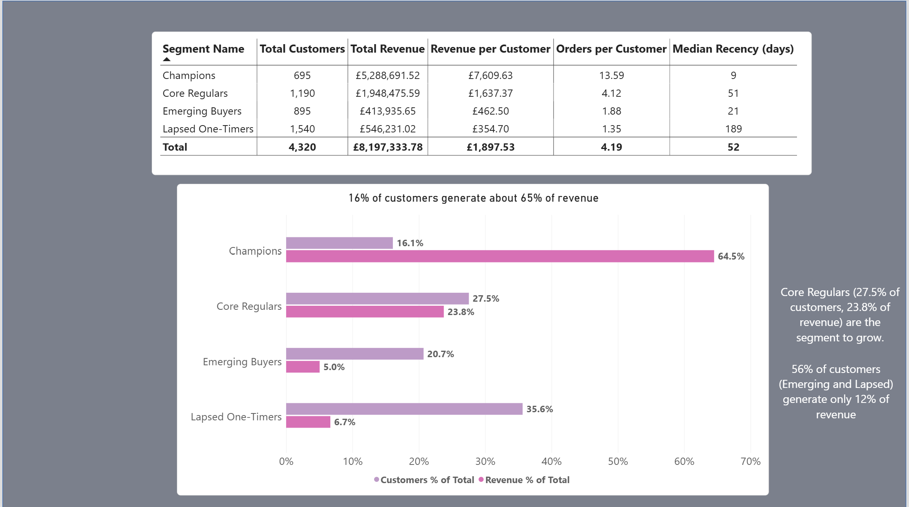

# Customer Segmentation for a UK Online Gift Retailer

**RFM + K-Means | MySQL · Python · Power BI**

Which customers drive revenue, which are at risk, and what should marketing do differently for each group? This project takes raw transaction data from raw CSV to segment-level recommendations: cleaning and RFM in SQL, clustering in Python, and a 4-page Power BI dashboard.

> **Headline:** 16.1% of customers generate 64.5% of revenue, and the top 1% (43 customers) generate 29.8%. Revenue is highly concentrated, so the recommendations protect key accounts, raise repeat frequency among mid-value regulars, and keep win-back spend proportional to value.

**Links:** [Full case study (Notion)](https://silent-nightshade-42c.notion.site/Customer-Segmentation-for-a-UK-Online-Gift-Retailer-40d2ad62a98a8023926fed1e9039c19b) · [Dashboard](https://liveutm-my.sharepoint.com/:u:/r/personal/afrina99_live_utm_my/_layouts/15/onedrive.aspx?id=%2Fpersonal%2Fafrina99%5Flive%5Futm%5Fmy%2FDocuments%2Fretail%5Fsegmentation%2Epbix&parent=%2Fpersonal%2Fafrina99%5Flive%5Futm%5Fmy%2FDocuments&share=cQqBaz0hOQp9QKnW%5FKBY9kPWEgUCEluGeJBbgkgcUwT5bk90%5FQ)

---

## Results at a glance

| Segment | Customers | % of customers | % of revenue | Revenue / customer | Orders / customer | Median recency |
|---|---|---|---|---|---|---|
| Champions | 695 | 16.1% | 64.5% | £7,610 | 13.6 | 9 days |
| Core Regulars | 1,190 | 27.5% | 23.8% | £1,637 | 4.1 | 51 days |
| Emerging Buyers | 895 | 20.7% | 5.0% | £463 | 1.9 | 21 days |
| Lapsed One-Timers | 1,540 | 35.6% | 6.7% | £355 | 1.35 | 189 days |

4,320 customers · £8,197,334 revenue · shares are of **identified-customer revenue** (see Limitations).



### Key findings

1. **Revenue is concentrated, even inside Champions.** Top 10 customers = 16.4% of revenue, top 1% = 29.8%, top 5% = 48.4%, top 20% = 73.6%. All top 10 are Champions, and four are outside the UK. Their credit notes are at most 2.6% of their revenue, so this is not a returns artefact.
2. **Emerging and Lapsed customers are 56.3% of customers but only 11.7% of revenue.**
3. **Core Regulars have a frequency gap, not a basket gap.** Their average order (~£397) is ~71% of a Champion's (~£560), but they order only ~30% as often (4.1 vs 13.6). One extra order per Core Regular would add roughly £472K (~5.8% of revenue). This is illustrative sizing, not a forecast; it assumes the same basket size.
4. **Segments differ in behaviour, not product taste.** The Regency cakestand is the top product in all four segments.
5. **Lapsed is partly recoverable.** 72.6% bought only once, but 28.8% (~440 customers) were active within the last 120 days.
6. **Emerging Buyers are genuinely new** (median first purchase 19 Oct 2011), but may be seasonal gift buyers, so their repeat rate is uncertain.

### Recommendations

| Segment | Goal | Actions | KPI |
|---|---|---|---|
| Champions: key accounts (~top 43) | Retain | Named account management, trade terms, alert on gaps in ordering | Account retention |
| Champions: the rest | Protect | Early access to new ranges, loyalty perks, avoid blanket discounts | Retention rate |
| Core Regulars | Raise frequency | Replenishment reminders, bundles from past purchases, early reactivation for the "At Risk" overlay | Orders per customer |
| Emerging Buyers | Win the 2nd purchase | Welcome series, cross-sell best-sellers, time-limited next-order offer | 30-60 day repeat rate |
| Lapsed One-Timers | Win back cheaply | Earlier low-cost nudge for those under 120 days, minimal spend on the rest | Reactivation rate, ROI |

**Proposed measurement:** randomised control group per campaign, comparing repeat rate and revenue per customer over 30-60 days. Small segments need a larger control share or a longer test. The dataset contains no campaign data, so this is a proposed design, not a result.

---

## Repository structure

```
├── README.md
├── sql/
│   ├── 01_load_and_clean.sql      # staging, type conversion, audit, cleaning, cancellation fix
│   └── 01-1_load_and_clean.sql    # clean the bug
├── notebooks/
│   └── 02_rfm_kmeans.ipynb        # EDA, k selection, clustering, validation
├── data/
│   └── rfm_segments.csv           # output: one row per customer with segment
├── dashboard/
│   ├── retail_segmentation.pbix
└── docs/
    └── data_quality_notes.md      # every number from the cleaning audit
```

The raw dataset is not included. Download it from the [UCI repository](https://archive.ics.uci.edu/dataset/352/online+retail).

---

## Method

### 1. Data loading
The CSV is loaded into a staging table with every column as text, then converted to proper types. The MySQL Workbench import wizard took 6 hours and loaded only 411,287 rows, so I load with pandas instead (`python/load_to_mysql.py`).

Loaded 536,454 of 541,909 source rows (99.0%), ending 8 Dec 2011 09:28. The missing rows are almost certainly the final ~1.5 days; every customer's history is complete up to 8 Dec.

### 2. Cleaning (SQL)

| Audit finding | Rows | Share of loaded rows |
|---|---|---|
| No CustomerID | 132,774 | 24.8% of rows, ~14.6% of raw revenue |
| Cancellation invoices (`C…`) | 9,214 | 1.7% |
| Quantity ≤ 0 (includes cancellations) | 10,548 | 2.0% |
| UnitPrice ≤ 0 | 2,511 | 0.5% |
| Exact duplicate rows | 5,228 | 1.0% |
| Non-product stock codes (POST, Manual, etc.) | 2980 | 0.5% |

The categories overlap, so they do not sum to the rows removed. After applying all rules, 388,124 rows remained in the first cleaned table (148,330 removed, 27.7%).

**Cleaning rules:** drop rows with no CustomerID (anonymous buyers can't be segmented), drop cancellation invoices, keep Quantity > 0 and UnitPrice > 0, keep only 5-digit product stock codes (removes POSTAGE, BANK CHARGES, Manual), remove exact duplicates, and compute `line_total = Quantity × UnitPrice`.

**A bug I found and fixed:** the first cleaned table removed cancellation rows but kept the original orders they cancelled, so fully cancelled orders still counted as revenue. I noticed because a storage jar and a picnic basket appeared in a segment's top products. They were two bulk orders (74,215 jars, £77K, and 60 baskets at £649.50, £39K) cancelled minutes later. The fix matches each cancellation to an earlier order by customer, product and quantity, plus large "Manual" credits of exactly equal value (the picnic basket case used a different stock code).

| | Before fix | After fix |
|---|---|---|
| Customers | 4,329 | 4,320 |
| Revenue | £8,505,143 | £8,197,334 |
| Lines removed | n/a | 4,001 (£307,809, 3.6% of gross revenue) |

### 3. RFM (SQL)
Recency = days since last purchase (from one day after the last transaction), Frequency = distinct orders, Monetary = total spend.

### 4. Clustering (Python)
- **Log transform + standardise:** spend and frequency are heavily right-skewed and k-means is distance-based.
- **Choosing k:** silhouette scores were k=2: 0.430, k=3: 0.339, k=4: 0.335, k=5: 0.319. k=2 only separates active from inactive customers, which is not actionable. k=3 and k=4 were effectively tied, so I compared profiles: k=4 splits the middle group into regular higher-spend customers (median £1,319, 4 orders) and recent lower-spend buyers (median £397, 2 orders), who need different actions.
- Segments are profiled with medians on the original units.
- **Cluster numbers are arbitrary** and shuffled when I reran after the data fix, so segments are named by profile, never by number.

### 5. Validation
- **Segment names:** Emerging Buyers' median first purchase is 19 Oct 2011 (genuinely new); Champions' is 16 Dec 2010.
- **Compared with rule-based RFM** (quintile scores on R and F): the methods agree at the extremes (94% of k-means Champions are rule-based Champions; 67% of Lapsed are Lost/Hibernating) and disagree in the middle. The rule ignores spend, so its "Champions" group is larger and lower-value (~1,100 customers, median £2,184, vs 695 and £3,604). Its "At Risk (was valuable)" label identifies about 215 Core Regulars who are quiet despite 4+ orders, and is used as a retention overlay.

### 6. Dashboard (Power BI)
Four pages: Business Overview, Segment Comparison, Segment Deep-Dive (single-select slicer, dynamic titles), and Recommendations. Data model: `fact_sales`, `dim_customer`, `dim_date`, connected by CustomerID and date. December 2011 is excluded from trend charts because it is a partial month.

---

## How to reproduce

**Requirements:** MySQL 8+, Python 3.10+, Power BI Desktop (Windows).

```bash
pip install pandas numpy scikit-learn matplotlib seaborn sqlalchemy pymysql openpyxl
```

1. **Get the data:** download *Online Retail* from UCI and save as `online_retail.csv` (UTF-8). Check whether dates are month/day/year or day/month/year, and adjust the `STR_TO_DATE` format in the SQL if needed.
2. **Create the database and staging table** (first part of `sql/01_load_and_clean.sql`).
3. **Load the CSV:**
   ```bash
   export MYSQL_USER=root
   export MYSQL_PASSWORD=your_password   # never hard-code passwords in committed files
   python python/load_to_mysql.py
   ```
   Check: `SELECT COUNT(*) FROM stg_online_retail;` should return 541,909 if the source is complete (mine returned 536,454).
4. **Run the rest of** `sql/01_load_and_clean.sql` (type conversion, audit, cleaning, cancellation fix) and then `sql/02_rfm.sql`.
5. **Run the notebook** `notebooks/02_rfm_kmeans.ipynb` top to bottom. Keep `random_state=42` and `n_init=10`. Read the RFM table with `pd.read_sql`, not by exporting from the Workbench grid (it limits results to 1,000 rows by default). After fitting, **match cluster numbers to segment names by profile**, not by cluster number.
6. **Export** `rfm_segments.csv` and `clean_sales.csv`, open `dashboard/retail_segmentation.pbix`, and refresh from those files.
7. **Check:** the segment table should show 695 / 1,190 / 895 / 1,540 customers, 4,320 in total, and £8,197,334 revenue.

---

## Limitations

- 536,454 of 541,909 rows loaded (99.0%); data ends 8 Dec 2011.
- Rows with no CustomerID (24.8% of loaded rows, ~14.6% of raw revenue) are excluded, so revenue shares describe **identified customers only** and overstate each segment's share of total business revenue.
- One year of data cannot separate growth from Christmas seasonality.
- Partial returns remain in revenue. Fully cancelled lines are matched on customer, product and quantity, which can slightly over-remove (for example if a customer bought the same quantity twice). "Cancelled" also includes ordinary full returns.
- Segments are useful groupings, not hard boundaries (silhouette ≈ 0.34).
- Rule-based frequency scores break ties by row order, so labels for low-frequency customers are approximate.
- Emerging Buyers' repeat rate is unknown; they may be seasonal gift buyers.
- The dataset description notes that many customers are wholesalers, but this analysis cannot identify which.
- One retailer, one year, so results may not generalise.

## What I would do next
Cluster the top-1% accounts separately, compare channel-level campaign performance, and build a repeat-purchase model for Emerging Buyers.

## Data source
Chen, D. (2015). *Online Retail* [Dataset]. UCI Machine Learning Repository. https://doi.org/10.24432/C5BW33. Check the dataset page for the current citation and licence.


